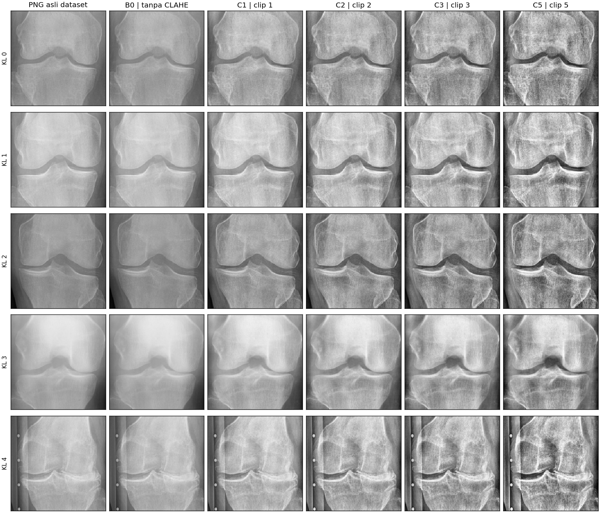

# Penelitian klasifikasi osteoartritis lutut dengan CLAHE dan CNN

Penelitian ini membandingkan citra rontgen tanpa CLAHE dengan citra yang diproses memakai empat nilai clip limit CLAHE. Pertanyaan utamanya: apakah perubahan kontras lokal memengaruhi kemampuan CNN membedakan tingkat keparahan osteoartritis (OA) lutut, dan pengaturan mana yang memberikan hasil validasi terbaik?

Implementasi mengikuti slide proposal: satu model EfficientNet-B0, lima kelas Kellgren-Lawrence (KL), grid CLAHE tetap 8x8, dan tiga seed pelatihan. Naskah Word masih mencantumkan alternatif ResNet50; proyek ini menetapkan EfficientNet-B0 agar arsitektur tidak ikut berubah selama perbandingan.

README ini menjelaskan cara menjalankan proyek sekaligus alasan setiap tahap. Hasil yang sudah diperoleh dibedakan dari rancangan yang masih perlu dijalankan. Teks proposal dan slide tersimpan di `aset_penelitian/referensi/`; laporan pelaksanaan ada di [aset_penelitian/referensi/STATUS.md](aset_penelitian/referensi/STATUS.md).

## Jalankan penelitian dari Jupyter

Buka [penelitian_oa_clahe_full_code.ipynb](penelitian_oa_clahe_full_code.ipynb), pilih kernel `.venv` proyek, lalu gunakan **Run All**. Notebook menampilkan hasil audit, distribusi kelas, gambar CLAHE, dan metrik pilot di bawah pembahasan masing-masing. Untuk pelatihan utama dan evaluasi akhir, gunakan sakelar pada sel pengaturan notebook. Kode audit, preprocessing, pelatihan, dan evaluasi tersedia langsung di dalam sel notebook. Keluaran notebook disimpan di `aset_penelitian/hasil/`.

Jika kernel belum tersedia, pasang dependensi notebook di lingkungan proyek:

```powershell
.\.venv\Scripts\python.exe -m pip install ipykernel matplotlib
```

`aset_penelitian/` mengelompokkan dataset, bobot, keluaran notebook, dan referensi. Lingkungan Python lokal tetap di `.venv/`.

## Panduan membaca

- [Tujuan dan dasar penelitian](#tujuan-dan-dasar-penelitian)
- [Dataset, label, dan audit](#dataset-label-dan-audit)
- [Pembagian data dan pencegahan kebocoran](#pembagian-data-dan-pencegahan-kebocoran)
- [Penjelasan CLAHE](#memahami-clahe-clip-limit-dan-grid-8x8)
- [Preprocessing dan augmentasi](#preprocessing-dan-augmentasi)
- [Model dan pengaturan pelatihan](#model-dan-pengaturan-pelatihan)
- [Seed, checkpoint, dan pemilihan konfigurasi](#seed-checkpoint-dan-pemilihan-konfigurasi)
- [Metrik dan cara membaca hasil](#metrik-dan-cara-membaca-hasil)
- [Instalasi dan urutan menjalankan proyek](#instalasi-dan-urutan-menjalankan-proyek)
- [Berkas keluaran dan status pekerjaan](#berkas-keluaran-dan-status-pekerjaan)
- [Referensi](#referensi)

## Tujuan dan dasar penelitian

Perbedaan antar-grade OA lutut dapat terlihat halus pada citra rontgen. Model perlu mempelajari pola yang berkaitan dengan label KL, sedangkan CLAHE mengubah kontras citra sebelum pola tersebut dipelajari. Penelitian ini menguji pengaruh perubahan itu melalui perbandingan yang terkontrol.

Empat penelitian dalam proposal memiliki peran berbeda:

| Acuan | Hubungan dengan penelitian ini |
| --- | --- |
| [Ahmed dan Mstafa, 2022][ahmed] | Menggunakan CLAHE pada OA lutut dengan clip limit 5,0 dan tiles (8,8); menjadi acuan awal parameter. |
| [Pi dkk., 2023][pi] | Menunjukkan bahwa preprocessing termasuk CLAHE tidak meningkatkan kinerja pada protokol mereka; mendukung perlunya baseline. |
| [Pandey, Rijal, dan Gaire, 2025][pandey] | Membandingkan filter peningkatan citra pada CNN untuk OA lutut; penelitian ini mempersempit fokus pada nilai clip limit. |
| [Muttaqin dkk., 2025][muttaqin] | Menggunakan ROI, CLAHE, dan DenseNet-169 pada OA panggul tiga kelas; relevan sebagai contoh penggunaan CLAHE, tetapi objek dan protokolnya berbeda. |

Angka kinerja dari artikel-artikel tersebut tidak dipakai sebagai hasil proyek ini dan tidak dibandingkan seolah berasal dari eksperimen yang sama. Dataset, model, jumlah kelas, dan pembagiannya berbeda.

Dalam rancangan ini, clip limit menjadi variabel yang diubah. Grid, pembagian data, arsitektur, bobot awal, augmentasi, dan pengaturan pelatihan dibuat sama antarskenario pada seed yang sama. Hasil yang diamati adalah macro-F1, accuracy, metrik per kelas, serta pola kesalahan pada confusion matrix.

## Dataset, label, dan audit

Data berasal dari [Knee Osteoarthritis Dataset with Severity Grading di Kaggle][dataset]. Arsip disimpan di `aset_penelitian/dataset/dataset.zip`, ekstraksinya di `aset_penelitian/dataset/raw/`, dan URL beserta checksum SHA-256 ada di `aset_penelitian/dataset/download.json`. Checksum berfungsi sebagai sidik jari berkas agar arsip yang dipakai dapat ditelusuri kembali.

Label target mengikuti lima grade KL pada proposal. Kategori berikut adalah ringkasan untuk membaca label dataset, bukan panduan diagnosis mandiri.

| Label | Kategori pada slide | Jumlah citra utama hasil audit |
| --- | --- | ---: |
| 0 | Normal | 3.253 |
| 1 | Meragukan | 1.495 |
| 2 | Ringan | 2.175 |
| 3 | Sedang | 1.086 |
| 4 | Berat | 251 |
| **Total** | | **8.260** |

Label dibaca dari folder kelas 0 sampai 4. Proyek ini tidak memberi label klinis baru dan tidak mengubah label berdasarkan prediksi model. Distribusi tersebut memperlihatkan ketidakseimbangan kelas: KL4 jauh lebih sedikit daripada KL0. Hal ini menjadi alasan menggunakan loss berbobot kelas dan macro-F1 sebagai ukuran utama.

### Apa yang diperiksa dalam audit?

Bagian **Audit dan pembagian data** pada notebook memeriksa keterbacaan citra, dimensi, mode kanal, label folder, duplikasi piksel identik, konflik label untuk piksel identik, serta kandidat ID pasien. Audit membaca semua citra untuk integritas data, termasuk calon subset uji, tetapi tidak mengukur kinerja model pada data uji.

Citra dengan piksel identik cukup diwakili satu berkas dalam manifest. Jika piksel identik memiliki label berbeda, seluruh kelompok tersebut dikeluarkan dari manifest untuk dicatat sebagai konflik. Berkas asli tetap disimpan. Audit ini belum memeriksa kemiripan yang tidak identik (*near-duplicate*) atau memastikan ketepatan diagnosis label.

Hasil audit yang tersedia: 9.786 PNG dapat dibaca, semuanya grayscale 224x224; tidak ditemukan citra rusak, duplikasi piksel identik, atau konflik label pada piksel identik. Dari jumlah tersebut, 8.260 citra train/val/test menjadi data utama. Sebanyak 1.526 citra `auto_test` dikecualikan karena 811 kandidat ID-nya juga muncul pada data utama; folder tambahan ini tidak dianggap sebagai sampel independen.

File `aset_penelitian/hasil/corrupt.csv` kosong karena audit tidak menemukan berkas rusak.

## Pembagian data dan pencegahan kebocoran

Ketiga subset memiliki tugas berbeda:

| Subset | Fungsi | Jumlah hasil pembagian |
| --- | --- | ---: |
| Latih, 70% | Memperbarui bobot model dan menghitung bobot kelas untuk loss. | 5.782 |
| Validasi, 10% | Memilih checkpoint, menghentikan pelatihan, dan memilih konfigurasi CLAHE. | 826 |
| Uji, 20% | Membandingkan baseline dengan CLAHE terpilih pada tahap akhir. | 1.652 |

Rasio 70/10/20 mengikuti slide dan rancangan yang dibahas dalam proposal. Ini merupakan pembagian yang dipilih untuk penelitian, bukan aturan universal. Proyek membangun ulang pembagian dari data utama; nama folder bawaan `train` atau `test` tidak lagi menentukan subset. Sumber pembagian yang digunakan program adalah kolom `split` pada manifest yang dibuat notebook di `aset_penelitian/hasil/manifest.csv`.

Dua lutut dari pasien yang sama berpotensi memiliki ciri serupa. Jika satu citra masuk data latih dan citra pasien yang sama masuk data uji, hasil bisa terlalu optimistis. Karena itu, tujuh digit awal nama berkas digunakan sebagai kandidat ID pasien dan semua citra dengan ID yang sama ditempatkan pada subset yang sama. Data utama memiliki 4.130 kandidat ID unik. ID ini masih berupa heuristik nama berkas, belum dikonfirmasi dengan metadata pasien resmi.

Pembagian menggunakan `StratifiedGroupKFold`: kelompok dijaga tetap utuh sambil mengupayakan distribusi kelas yang serupa [dokumentasi scikit-learn][group-split]. Sepuluh fold dialokasikan menjadi tujuh untuk latih, satu validasi, dan dua uji. Ini adalah cara membentuk satu pembagian tetap, bukan menjalankan pelatihan cross-validation sepuluh kali. Rasio dapat mendekati target bila ukuran kelompok tidak memungkinkan pembagian tepat; pada hasil saat ini jumlah citra tepat 70/10/20.

Split seed 42 menjaga pembagian tetap. Kelima skenario dan ketiga seed pelatihan menggunakan manifest yang sama. Audit tidak menemukan overlap kandidat ID atau piksel identik antarsubset. Jika pemetaan pasien terverifikasi tersedia, isi `PATIENT_MAP` di sel pengaturan dengan lokasi CSV yang memiliki kolom `path,patient_id`. Kolom `path` berisi jalur relatif terhadap `DATASET`. Perubahan pembagian setelah eksperimen dimulai memerlukan pengulangan seluruh run.

## Memahami CLAHE, clip limit, dan grid 8x8

Pada citra rontgen, perbedaan tingkat keabuan di sekitar sendi kadang kurang terlihat. CLAHE (*Contrast Limited Adaptive Histogram Equalization*) digunakan untuk menyesuaikan kontras pada bagian-bagian kecil citra. Tujuan penggunaannya dalam penelitian ini adalah menguji apakah penyesuaian tersebut membantu model membedakan KL grade 0-4. Citra yang terlihat lebih jelas belum tentu menghasilkan klasifikasi yang lebih baik; pengaruhnya tetap harus diukur melalui eksperimen.

### Bagaimana CLAHE bekerja?

CLAHE membagi citra menjadi beberapa wilayah kecil yang disebut *tile*. Pada setiap tile, CLAHE menghitung histogram, yaitu jumlah piksel pada setiap tingkat keabuan, lalu membentuk pemetaan intensitas untuk menyesuaikan kontras lokal. Puncak histogram dibatasi agar penguatan kontras tidak berlebihan. Kelebihan frekuensi yang dipotong didistribusikan kembali. Hasil antar-tile digabungkan dengan interpolasi agar peralihannya tidak membentuk batas kotak yang kasar. Mekanisme ini dijelaskan dalam [tutorial histogram equalization OpenCV][opencv-tutorial].

### Apa yang diatur oleh clip limit?

**Clip limit mengatur batas pemotongan puncak histogram pada setiap tile.** Nilai yang lebih rendah memberi pembatasan lebih ketat. Nilai yang lebih tinggi memungkinkan perubahan kontras lebih kuat, tetapi noise juga bisa semakin terlihat. Besarnya perubahan tetap bergantung pada distribusi intensitas citra, sehingga kenaikan clip limit tidak selalu memberi perubahan visual atau kinerja yang sebanding.

Sebagai contoh, `clipLimit=2.0` adalah nilai parameter pembatasan kontras pada OpenCV. Angka tersebut tidak berarti citra dibuat dua kali lebih terang, dan `clipLimit=1.0` tetap merupakan perlakuan CLAHE. Baseline dibuat dengan melewati tahap CLAHE sepenuhnya. Definisi parameternya dapat dilihat pada [dokumentasi kelas CLAHE OpenCV][opencv-clahe].

### Apa arti grid 8x8?

**Pada OpenCV, `tileGridSize=(8, 8)` berarti 8 kolom dan 8 baris tile**, sehingga ada 64 wilayah lokal. Angka 8x8 menyatakan jumlah pembagian citra, bukan ukuran tile dalam piksel. Dokumentasi OpenCV menyebut parameter ini sebagai jumlah tile pada baris dan kolom [OpenCV, dokumentasi CLAHE][opencv-clahe].

Dalam proyek ini, citra diubah dahulu menjadi 224x224 piksel. Karena 224 dibagi 8 sama dengan 28, setiap tile berukuran **28x28 piksel**. Jadi, satu citra diproses melalui 64 wilayah, masing-masing berukuran 28x28 piksel, kemudian hasilnya digabungkan kembali.

### Mengapa memakai clip limit 1, 2, 3, dan 5 dengan grid tetap?

Acuan langsung dalam proposal adalah **Ahmed dan Mstafa (2022)**. Pada bagian 3.2, *Data Preprocessing*, peneliti tersebut menggunakan clip limit **5,0** dan tiles **(8, 8)** untuk citra OA lutut [Ahmed dan Mstafa, 2022][ahmed]. Pengaturan ini menjadi acuan awal, bukan bukti bahwa nilai yang sama pasti paling baik untuk proyek ini. Artikel tersebut memakai citra hasil resize 112x112 piksel, sedangkan proyek ini memakai 224x224 piksel. Walaupun jumlah tile sama, ukuran piksel setiap tile berbeda.

Nilai **1,0; 2,0; 3,0; dan 5,0** adalah variasi eksperimen yang ditetapkan dalam proposal dan slide. Rentang ini membandingkan beberapa tingkat pembatasan kontras, dengan 5,0 mencakup nilai pada penelitian acuan. Keempat nilai tersebut tidak diklaim sebagai rekomendasi langsung atau hasil pencarian parameter optimal dari Ahmed dan Mstafa.

| Kode | Perlakuan | Clip limit | Tile grid |
| --- | --- | --- | --- |
| B0 | Baseline tanpa CLAHE | - | - |
| C1 | CLAHE | 1,0 | 8x8 |
| C2 | CLAHE | 2,0 | 8x8 |
| C3 | CLAHE | 3,0 | 8x8 |
| C5 | CLAHE | 5,0 | 8x8 |

Grid dibuat tetap agar perbandingan berfokus pada **pengaruh clip limit**. Jika grid ikut diubah, perbedaan hasil dapat berasal dari dua parameter sekaligus. Karena itu, penelitian ini belum menjawab grid mana yang paling baik. Baseline tetap menerima grayscale, resize, dan normalisasi; perbedaannya terletak pada ada atau tidaknya CLAHE.

Alasan manfaat CLAHE perlu diuji juga didukung oleh **Pi dkk. (2023)**. Mereka mencoba beberapa preprocessing, termasuk CLAHE, dan melaporkan bahwa perlakuan tersebut tidak meningkatkan kinerja dalam protokol mereka [Pi dkk., 2023][pi]. Temuan ini mendasari perbandingan dengan baseline, tanpa menganggap CLAHE pasti lebih unggul.

### Contoh penerapan pada proyek

Contoh berikut menunjukkan skenario C2. Implementasi semua skenario ada pada fungsi `prepare_image` di notebook. Nilai clip limit tercantum di `CFG` pada sel pengaturan.

```python
# citra_grayscale sudah berukuran 224x224 dan bertipe uint8.
clahe = cv2.createCLAHE(clipLimit=2.0, tileGridSize=(8, 8))
hasil = clahe.apply(citra_grayscale)
```

Kelima skenario memakai pembagian data, model, augmentasi, dan pengaturan pelatihan yang sama. Masing-masing dilatih dengan seed 42, 123, dan 2026. Konfigurasi CLAHE dipilih berdasarkan rerata macro-F1 validasi dari tiga seed; rerata loss validasi digunakan jika nilainya seri. Sesudah pemilihan selesai, baseline dan konfigurasi terpilih dibandingkan pada data uji. Hasil uji tidak digunakan untuk memilih clip limit.

### Melihat langsung hasil clip limit

Demonstrasi memakai satu citra asli dari setiap KL grade pada subset latih. Setiap baris menampilkan citra yang sama, mulai dari baseline sampai clip limit 1, 2, 3, dan 5, dengan grid tetap 8x8. Rentang tampilan dikunci 0-255 agar perbedaannya tidak dipengaruhi penyesuaian kontras otomatis saat gambar ditampilkan.



Bagian **Tampilkan PNG asli dari dataset** menampilkan lima berkas PNG langsung dari dataset, satu per grade KL, beserta jalur sumbernya. Nama folder pada jalur menunjukkan pembagian bawaan Kaggle, sedangkan kolom `split` menunjukkan pembagian penelitian. Bagian **Perbandingan visual clip limit** menampilkan PNG sumber, B0, dan empat hasil CLAHE dari sumber yang sama. Jalankan **Pilot lima skenario** untuk melihat tabel metrik. Tabel pilot berasal dari satu epoch dengan seed 42 serta 40 citra latih dan 20 citra validasi yang sama untuk semua skenario. Pemilihan clip limit untuk penelitian utama memakai rekap validasi dari 15 run.

## Preprocessing dan augmentasi

Semua skenario menerima urutan pemrosesan yang sama. Perbedaannya hanya pada tahap CLAHE.

| Tahap | Yang dilakukan | Tujuan |
| --- | --- | --- |
| Grayscale | Citra diubah menjadi satu kanal keabuan. | Menyeragamkan masukan. |
| Resize | Ukuran menjadi 224x224 dengan interpolasi bilinear. | Membentuk ukuran masukan yang tetap. |
| CLAHE | Dilewati pada B0; digunakan sesuai clip limit pada C1/C2/C3/C5. | Memberikan perlakuan kontras yang diuji. |
| Augmentasi latih | Rotasi acak -5 sampai +5 derajat dan horizontal flip dengan peluang 0,5. | Memberi variasi posisi selama model belajar. |
| Tiga kanal | Kanal grayscale disalin tiga kali. | Menyesuaikan bentuk masukan bobot ImageNet. |
| Normalisasi | Intensitas dibagi 255 lalu distandardisasi per kanal. | Menyesuaikan skala masukan model pralatih. |

Rotasi memakai interpolasi bilinear dengan tepi kosong berwarna hitam. Peluang flip 0,5 berarti setiap pemanggilan citra mempunyai kesempatan 50% untuk dicerminkan; jumlah citra yang tercermin tidak harus tepat setengah pada setiap epoch. Augmentasi dilakukan saat citra dimuat, sehingga tidak membuat berkas citra tambahan di folder dataset.

Validasi dan uji tetap memakai preprocessing sesuai skenario, termasuk CLAHE untuk skenario CLAHE, tetapi tanpa rotasi atau flip acak. Dengan demikian, pengukuran dilakukan pada masukan yang tetap. Augmentasi brightness dan contrast tidak digunakan karena kontras adalah perlakuan yang sedang diteliti. Besar rotasi dan peluang flip mengikuti slide, bukan hasil pencarian nilai terbaik pada data uji.

Normalisasi memakai rumus `x = intensitas / 255`, kemudian `z = (x - mean) / std`. Mean ImageNet adalah `[0.485, 0.456, 0.406]`, sedangkan std adalah `[0.229, 0.224, 0.225]`, sesuai [dokumentasi bobot Torchvision][torchvision]. Sebagai ilustrasi perhitungan, intensitas 128 menjadi 0,50196, lalu pada kanal pertama menjadi sekitar 0,0741. Kanal grayscale sama sebelum standardisasi, tetapi hasil standardisasi ketiga kanal berbeda karena mean dan std-nya berbeda.

Proyek mengikuti resize langsung 224x224 pada slide. Transformasi inferensi bawaan Torchvision memakai resize dan center crop; proyek tidak memakai rangkaian bawaan tersebut secara utuh. Statistik normalisasinya tetap mengikuti bobot ImageNet.

## Model dan pengaturan pelatihan

### Mengapa EfficientNet-B0 dan bobot ImageNet?

CNN mempelajari pola visual melalui lapisan konvolusi. EfficientNet adalah keluarga CNN yang dikembangkan dengan mempertimbangkan keseimbangan kedalaman, lebar, dan resolusi [Tan dan Le, 2019][efficientnet]. B0 digunakan sebagai satu arsitektur tetap pada penelitian ini agar perbandingan tidak bercampur dengan perubahan model. Penggunaan B0 tidak menyatakan bahwa model ini sudah terbukti paling baik untuk dataset ini.

Bobot ImageNet memberikan titik awal dari pelatihan pada kumpulan citra umum. Bobot tersebut belum menjadi model diagnosis OA. Pada proyek ini, seluruh parameter diperbarui menggunakan citra lutut (*full fine-tuning*), dan lapisan klasifikasi diganti menjadi lima keluaran. Implementasi memakai `EfficientNet_B0_Weights.IMAGENET1K_V1` dari [Torchvision][torchvision].

Alurnya adalah masukan 3x224x224, ekstraksi fitur EfficientNet-B0, global average pooling, dropout, lalu lapisan klasifikasi lima kelas. Pooling merangkum peta fitur sebelum klasifikasi. Dropout 0,3 secara acak menonaktifkan sebagian elemen masukan lapisan akhir selama pelatihan untuk regularisasi; dropout dinonaktifkan saat evaluasi. Nilai 0,3 mengikuti slide.

Model menghasilkan lima skor mentah (*logits*). Kelas dengan skor tertinggi menjadi prediksi. Jika diperlukan probabilitas, skor dapat diubah memakai softmax. Selama pelatihan, softmax tidak ditambahkan sebelum `CrossEntropyLoss` karena fungsi loss sudah menangani perhitungan tersebut [PyTorch, CrossEntropyLoss][cross-entropy].

### Arti pengaturan pelatihan

Nilai berikut berasal dari rancangan pada slide dan diterapkan sama untuk seluruh skenario. Belum ada klaim bahwa kombinasi ini merupakan hasil optimasi hyperparameter.

| Pengaturan | Nilai | Penjelasan |
| --- | --- | --- |
| Optimizer | Adam | Mengatur pembaruan bobot berdasarkan gradien. |
| Learning rate | 0,0001 | Menentukan skala langkah pembaruan bobot. |
| Weight decay | 0,00001 | Penalti pada besarnya bobot untuk regularisasi. |
| Batch size | 32 | Maksimum citra yang diproses bersama sebelum satu pembaruan bobot. |
| Maksimum epoch | 150 | Batas atas putaran pembacaan seluruh data latih. |
| Early stopping | Patience 12 | Berhenti setelah 12 epoch berurutan tanpa kenaikan macro-F1 validasi. |
| Dropout | 0,3 | Peluang penonaktifan elemen pada dropout sebelum classifier saat latih. |
| Loss | Cross-entropy berbobot kelas | Menghitung kesalahan dengan bobot yang berbeda untuk setiap kelas. |

Optimizer di kode adalah `torch.optim.Adam`, mengikuti [dokumentasi Adam PyTorch][adam]. Satu epoch berisi beberapa batch; epoch tidak sama dengan satu kali pembaruan bobot. Maksimum 150 epoch juga tidak berarti setiap run harus selesai pada epoch 150, karena early stopping dapat menghentikannya lebih awal. Tidak ada learning-rate scheduler pada implementasi awal ini.

### Mengapa loss diberi bobot kelas?

Jika semua citra diberi bobot sama, kelas yang banyak dapat lebih mendominasi pembelajaran. Bobot kelas dihitung hanya dari subset latih dengan rumus:

```text
bobot kelas k = N_latih / (5 * jumlah citra latih pada kelas k)
```

Kelas yang lebih sedikit mendapat bobot lebih besar. Ini menyesuaikan kontribusi kesalahan dalam loss, tanpa menambah jumlah citra kelas tersebut. Perhitungan bobot tidak menggunakan data validasi atau uji. `CrossEntropyLoss` menerima bobot per kelas sebagaimana dijelaskan [PyTorch][cross-entropy]. Loss validasi memakai bobot kelas latih yang sama; accuracy dan macro-F1 tetap dihitung dari prediksi tanpa pembobotan loss.

Pengaturan operasional ada di `CFG` pada bagian 1 notebook. Batas epoch utama memakai `max_epochs`, sementara pengaturan pilot berada di `pilot`. Catat setiap perubahan sebelum memulai eksperimen.

## Seed, checkpoint, dan pemilihan konfigurasi

Seed adalah nilai awal pengacakan. Pengacakan memengaruhi inisialisasi classifier, urutan data latih, augmentasi, dan operasi acak saat pelatihan. Proyek menggunakan seed **42, 123, dan 2026**, sehingga lima skenario menghasilkan **15 pelatihan**. Angka seed merupakan pengenal pengacakan, bukan tingkat kualitas model.

Seed pelatihan berbeda dari split seed. Split seed 42 menentukan satu pembagian data tetap, sedangkan tiga seed pelatihan mengulangi proses belajar pada pembagian tersebut. Ini bukan tiga pembagian dataset atau tiga fold cross-validation.

Pada seed yang sama, seluruh skenario memakai pengaturan pengacakan dan inisialisasi yang sama agar perbandingan lebih terkendali. Reproduksibilitas lintas perangkat dan versi library tetap dapat berbeda. Ringkasan tiga seed memberi gambaran variasi akibat pengacakan; simpangan bakunya bukan interval kepercayaan klinis.

Pemilihan dilakukan pada dua tingkat:

1. **Checkpoint dalam satu run.** Setiap akhir epoch, model diperiksa pada validasi. Bobot dengan macro-F1 validasi tertinggi disimpan sebagai `best.pt`. Jika macro-F1 sama, loss validasi yang lebih rendah memecahkan seri. Early stopping tetap menghitung epoch tanpa peningkatan macro-F1; turunnya loss saja tidak mengulang penghitung patience.
2. **Konfigurasi di antara perlakuan CLAHE.** Setelah 15 run lengkap, macro-F1 validasi dirata-ratakan untuk setiap skenario dari tiga seed. Skenario CLAHE dengan rerata tertinggi dipilih. Jika seri, rerata loss validasi lebih rendah dipilih; jika masih persis sama, kode skenario menentukan urutan secara deterministik.

Baseline tetap menjadi pembanding. Jika semua CLAHE lebih buruk daripada baseline, hasil tersebut tetap dilaporkan. Konfigurasi CLAHE terpilih berarti yang terbaik di antara empat perlakuan yang diuji, bukan jaminan mengungguli baseline.

Rerata adalah jumlah nilai dari tiga seed dibagi tiga. Simpangan baku menggunakan rumus sampel dengan penyebut `n-1` atau `ddof=1`. Data uji tidak dipakai untuk memilih seed, epoch, checkpoint, ataupun clip limit.

## Metrik dan cara membaca hasil

| Metrik | Pertanyaan yang dijawab |
| --- | --- |
| Accuracy | Dari seluruh citra, berapa proporsi yang kelasnya diprediksi benar? |
| Precision kelas k | Dari semua prediksi kelas k, berapa proporsi yang benar-benar kelas k? |
| Recall kelas k | Dari semua citra yang sebenarnya kelas k, berapa proporsi yang berhasil dikenali? |
| F1 kelas k | Seberapa seimbang precision dan recall kelas tersebut? |
| Macro-F1 | Berapa rerata F1 dari kelima kelas jika setiap kelas diberi bobot yang sama? |
| Support | Berapa jumlah citra sebenarnya pada setiap kelas di subset yang diukur? |
| Confusion matrix | Kelas mana yang benar dan kelas mana yang paling sering tertukar? |

Definisi metrik mengikuti [classification report scikit-learn][metrics]. Dengan `TP` sebagai prediksi benar untuk suatu kelas, `FP` sebagai prediksi kelas tersebut yang keliru, dan `FN` sebagai citra kelas tersebut yang tidak dikenali:

```text
Precision = TP / (TP + FP)
Recall    = TP / (TP + FN)
F1        = 2 * Precision * Recall / (Precision + Recall)
Macro-F1  = (F1_KL0 + F1_KL1 + F1_KL2 + F1_KL3 + F1_KL4) / 5
```

Implementasi memberi nilai 0 untuk metrik yang pembaginya nol (`zero_division=0`). Macro-F1 dipilih sebagai ukuran utama karena kelas sedikit tetap mendapat peran yang sama dalam rerata. Accuracy tetap dilaporkan, tetapi perlu dibaca bersama recall dan F1 setiap kelas.

Confusion matrix menempatkan **label aktual pada baris** dan **prediksi pada kolom**. Nilai diagonal adalah prediksi benar. Misalnya, sel baris KL1 kolom KL2 mencatat citra berlabel KL1 yang diprediksi sebagai KL2. Tidak ada angka contoh yang dimasukkan sebagai hasil eksperimen.

Pada evaluasi akhir, baseline dan konfigurasi CLAHE terpilih masing-masing diuji untuk ketiga seed, sehingga ada enam checkpoint yang dievaluasi pada subset uji yang sama. Ini bukan ensemble: setiap model dilaporkan sendiri, kemudian diringkas dengan rerata dan simpangan baku. Selisih antarskenario dapat dibaca per pasangan seed. Perbedaan rerata saja belum membuktikan signifikansi statistik; proyek belum menyediakan uji signifikansi atau validasi eksternal.

## Instalasi dan urutan menjalankan proyek

Buka [notebook kode lengkap](penelitian_oa_clahe_full_code.ipynb) di Jupyter atau VS Code. Pilih kernel `.venv` proyek. Jika menyiapkan lingkungan baru dari PowerShell di folder proyek, gunakan:

```powershell
python -m venv .venv
.\.venv\Scripts\python.exe -m pip install -r requirements.txt ipykernel matplotlib
```

1. Jalankan sel **Pengaturan** dan **Siapkan dataset**. Notebook memakai direktori `DATASET` jika citra sudah tersedia, atau mengekstrak dan mengunduh arsip jika diperlukan.
2. Jalankan **Audit dan pembagian data**, **Preprocessing dan augmentasi**, serta **Model dan metrik**. Hasil audit, distribusi kelas, contoh CLAHE, dan pemeriksaan tensor muncul pada bagian masing-masing.
3. Jalankan **Fungsi pelatihan** dan **Pilot lima skenario**. Tabel dan confusion matrix validasi muncul setelah sel selesai.
4. Untuk eksperimen utama, atur `LATIH_UTAMA = True` pada bagian 1 dan pilih **Run All**. Bagian 8 menampilkan rekap validasi dan memilih konfigurasi CLAHE setelah 15 run selesai.
5. Setelah konfigurasi terpilih, atur `UJI_AKHIR = True` dan pilih **Run All**. Bagian 9 menampilkan perbandingan baseline dan CLAHE terpilih pada data uji.

Gunakan `LATIH_UTAMA = False` dan `UJI_AKHIR = False` untuk membaca ulang atau menjalankan audit dan pilot saja. Pelatihan utama dapat memakan waktu lama di CPU. Checkpoint yang lengkap dan cocok dengan konfigurasi, manifest, serta kode dapat dipakai kembali.

## Berkas keluaran dan status pekerjaan

| Berkas atau folder | Isi |
| --- | --- |
| `aset_penelitian/dataset/raw/` | Citra dataset yang dipakai sebagai masukan. |
| `aset_penelitian/hasil/audit.json` dan `inventory.csv` | Ringkasan audit dan inventaris citra. |
| `aset_penelitian/hasil/manifest.csv` | Label dan subset setiap citra yang digunakan. |
| `aset_penelitian/hasil/perbandingan_clahe.png` | Perbandingan visual lima skenario. |
| `aset_penelitian/hasil/pilot_comparison.csv` dan `aset_penelitian/hasil/runs_terstruktur/pilot/` | Metrik dan checkpoint pilot. |
| `aset_penelitian/hasil/runs_terstruktur/main/` | Riwayat dan checkpoint pelatihan utama setelah dijalankan. |
| `aset_penelitian/hasil/validasi_per_seed.csv` dan `ringkasan_validasi.csv` | Rekap validasi setelah 15 run selesai. |
| `aset_penelitian/hasil/uji_akhir/` | Metrik uji, confusion matrix, dan prediksi per citra setelah evaluasi akhir. |

Audit dan pilot sudah dijalankan pada data asli dengan bobot ImageNet. Notebook menyimpan hasil validasi untuk kelima skenario. Pelatihan utama dan evaluasi uji adalah tahap berikutnya. Kandidat ID pasien masih berasal dari nama berkas. Audit belum memeriksa near-duplicate atau mengonfirmasi diagnosis pada label dataset.

## Referensi

Referensi artikel berikut mengikuti acuan proposal dan slide. Dokumentasi perangkat lunak ditambahkan untuk menjelaskan implementasi, bukan sebagai sumber yang menetapkan seluruh angka hyperparameter.

1. Ahmed, S. M., & Mstafa, R. J. (2022). *Identifying Severity Grading of Knee Osteoarthritis from X-ray Images Using an Efficient Mixture of Deep Learning and Machine Learning Models*. Diagnostics, 12(12), 2939. [Artikel dan DOI][ahmed]. Bagian 3.2 menjadi acuan clip limit 5,0 dan tiles (8,8). Nama penulis pertama pada artikel asli adalah Sozan Mohammed Ahmed.
2. Pi, S.-W., Lee, B.-D., Lee, M. S., & Lee, H. J. (2023). *Ensemble deep-learning networks for automated osteoarthritis grading in knee X-ray images*. Scientific Reports, 13, 22887. [Artikel][pi]. DOI: 10.1038/s41598-023-50210-4.
3. Pandey, K., Rijal, S., & Gaire, A. (2025). *Knee Osteoarthritis Severity Classification Using CNN and Image Enhancement Filters*. NCCS Research Journal, 4(1), 73-98. [Artikel][pandey]. DOI: 10.3126/nccsrj.v4i1.84359. Inisial mengikuti nama Krisha Pandey, Sabina Rijal, dan Asmita Gaire pada artikel.
4. Muttaqin, F., dkk. (2025). *A Combination Method of ROI, CLAHE, and DenseNet-169 for Hip Osteoarthritis Detection*. Engineering, Technology & Applied Science Research, 15(3), 22690-22697. [Artikel][muttaqin]. DOI: 10.48084/etasr.10576.
5. OpenCV. [CLAHE Class Reference][opencv-clahe] dan [Histograms - 2: Histogram Equalization][opencv-tutorial]. Definisi parameter dan mekanisme peningkatan kontras lokal.
6. Tan, M., & Le, Q. (2019). *EfficientNet: Rethinking Model Scaling for Convolutional Neural Networks*. PMLR, 97, 6105-6114. [Artikel EfficientNet][efficientnet].
7. Torchvision 0.24. [efficientnet_b0][torchvision]. Arsitektur yang disediakan, pilihan bobot ImageNet, dan statistik normalisasi.
8. PyTorch 2.9. [Adam][adam] dan [CrossEntropyLoss][cross-entropy]. Perilaku optimizer serta loss berbobot kelas.
9. scikit-learn. [StratifiedGroupKFold][group-split] dan [classification_report][metrics]. Pembagian berdasarkan kelompok serta definisi metrik.

[dataset]: https://www.kaggle.com/datasets/shashwatwork/knee-osteoarthritis-dataset-with-severity
[ahmed]: https://doi.org/10.3390/diagnostics12122939
[pi]: https://pmc.ncbi.nlm.nih.gov/articles/PMC10739741/
[pandey]: https://nepjol.info/index.php/nccsrj/article/download/84359/64339
[muttaqin]: https://www.etasr.com/index.php/ETASR/article/view/10576
[opencv-clahe]: https://docs.opencv.org/4.x/d6/db6/classcv_1_1CLAHE.html
[opencv-tutorial]: https://docs.opencv.org/4.x/d5/daf/tutorial_py_histogram_equalization.html
[efficientnet]: https://proceedings.mlr.press/v97/tan19a.html
[torchvision]: https://docs.pytorch.org/vision/0.24/models/generated/torchvision.models.efficientnet_b0.html
[adam]: https://docs.pytorch.org/docs/2.9/generated/torch.optim.Adam.html
[cross-entropy]: https://docs.pytorch.org/docs/2.9/generated/torch.nn.CrossEntropyLoss.html
[group-split]: https://scikit-learn.org/stable/modules/generated/sklearn.model_selection.StratifiedGroupKFold.html
[metrics]: https://scikit-learn.org/stable/modules/generated/sklearn.metrics.classification_report.html
